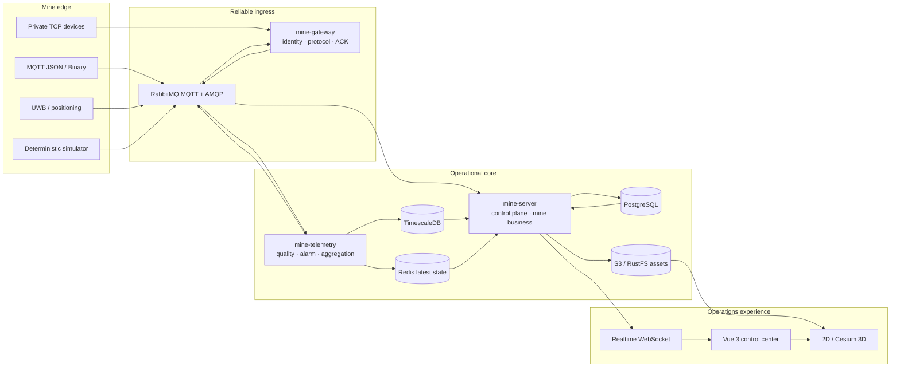

<div align="center">

# ⛏️ mine-platform

### Open-source industrial IoT infrastructure for smart mines

**Offline-first. Weak-network aware. Protocol-extensible. Built around operational truth.**

[](https://github.com/Boscodoggggg/mine-platform/actions/workflows/ci.yml)
[](LICENSE)
[](https://openjdk.org/projects/jdk/21/)
[](https://vuejs.org/)
[](#project-maturity)

[简体中文](README.zh-CN.md) · [Documentation](docs/README.md) · [Standalone deployment](deploy/README.md) · [Contributing](CONTRIBUTING.md) · [Security](SECURITY.md)

</div>

---

mine-platform is a self-hosted IoT and operations platform for mines where connectivity is unreliable, vendor protocols are fragmented, and cloud access cannot be assumed. It connects MQTT, private TCP, binary devices and positioning sources to a reliable telemetry, alarm, command, spatial and production workflow — all deployable inside the mine network.

It is not a themed generic IoT dashboard. The repository models the hard parts of a mine system explicitly: replay-safe ingestion, device identity, event-time ordering, dual coordinates, geofences, shifts, haulage work orders, immutable operational evidence, offline delivery and recovery boundaries.

> [!IMPORTANT]
> The repository has a broad automated engineering baseline and is currently in **Phase 4 production hardening**. Real devices, site calibration, target capacity, HA, disaster-recovery drills and 24/72-hour soak evidence remain required before a customer production release.

## Why mine-platform

| | Capability | What it means in the field |
|---|---|---|
| 🔌 | **Protocol-extensible edge** | Configuration-driven MQTT JSON plus versioned MQTT/TCP binary plugins behind trusted device identity. |
| 📡 | **Weak-network correctness** | Sequence, boot identity, idempotent Inbox/Outbox, publisher confirms, retry and late-data semantics instead of optimistic message handling. |
| 🧭 | **Mine-native spatial model** | Sites, vehicles, people, tags, UWB observations, dual coordinates, routes, geofences and deterministic enter/leave/dwell events. |
| 🚛 | **Operations, not just telemetry** | Shifts, haulage work orders, exception candidates, immutable facts, corrections and fixed-watermark statistics. |
| 🚨 | **Governed alarms and notifications** | Versioned strategies, persistent alarm state, acknowledgement/closure workflow, built-in provider control plane and escalation policies. |
| 🗺️ | **Offline 2D/3D workspace** | Cesium assets served locally, live operational overlays and an independent 2D fallback when WebGL or 3D resources fail. |
| 📦 | **Private and offline delivery** | Reproducible Standalone Compose, locked images, SBOM, checksums, health gates and an offline installation bundle. |
| 🛡️ | **Fail-closed recovery** | Same-version cold backup/restore validates manifests, dual checksums, archive paths and image IDs, then restores only into new volumes. |

## Architecture



The control plane and data plane stay deliberately separate. Published configuration is immutable and distributed as a runtime snapshot; device traffic cannot choose its own plugin, tenant or mine scope. Historical facts remain in PostgreSQL/TimescaleDB, while Redis is treated as rebuildable latest state.

## What is already here

| Domain | Automated baseline |
|---|---|
| Device connectivity | MQTT JSON, MQTT binary plugin SPI, TCP binary plugin SPI, TLS, identity snapshots, command ACK and deterministic simulators |
| Telemetry | Unified messages, quality policy, idempotent processing, TimescaleDB history, Redis latest state and WebSocket updates |
| Governance | Product/device models, versioned strategies, retention protection, numeric rollups, bounded recomputation and audit |
| Alarms | Dual-source evaluation, persistent state machine, reliable events, acknowledgement/closure and notification control plane |
| Mine operations | Site scope, assets, time-effective bindings, UWB positions, dual coordinates, routes, geofences, shifts and work orders |
| Visualization | Realtime tracking, bounded trails, spatial/operation overlays, secure GLB/3D Tiles and independent 2D degradation |
| Delivery | Standalone Compose, observability, offline bundle, image locks, CycloneDX SBOM and same-version cold recovery |

The exact implemented/deferred matrix lives in the [roadmap](docs/12-roadmap-and-codex-workflow.md). Public API contracts are maintained in [OpenAPI](docs/openapi/mine-api.yaml).

## Technology

| Layer | Stack |
|---|---|
| Backend | Java 21, Spring Boot 4, MyBatis, Sa-Token, Flyway |
| Device edge | Netty, Eclipse Paho, versioned Java protocol SPI |
| Messaging | RabbitMQ 4 with MQTT and AMQP, quorum queues, DLQ and publisher confirms |
| Data | PostgreSQL 18, TimescaleDB OSS, Redis |
| Frontend | Vue 3, TypeScript, Vite, Naive UI, ECharts, Cesium |
| Object storage | Standard S3 API; RustFS in the Standalone baseline |
| Quality and delivery | JUnit, Testcontainers, Vitest, Playwright, Docker Compose, Prometheus, Grafana, Loki, Alloy, CycloneDX |

## Quick start

### 1. Build and run the automated baseline

Prerequisites: JDK 21, Node.js 20.19+, pnpm 10.5+ and Docker Engine 24+ with Compose v2.

```bash
git clone https://github.com/Boscodoggggg/mine-platform.git
cd mine-platform

./mvnw -B -ntp test
pnpm --dir mine-web install --frozen-lockfile
pnpm --dir mine-web typecheck
pnpm --dir mine-web test:unit
pnpm --dir mine-web build
```

Run the complete repository gate, including deployment contracts and SBOM generation:

```bash
bash scripts/verify.sh
```

### 2. Start a Standalone environment

The production-shaped single-host profile includes the application services, RabbitMQ, PostgreSQL, TimescaleDB, Redis, RustFS, HTTPS/MQTTS ingress and an optional observability profile.

Follow the [Standalone deployment guide](deploy/README.md) to stage artifacts under `deploy/`, configure `deploy/.env`, mount site certificates, validate prerequisites and start the stack. Never use example credentials or development certificates in a real mine.

### 3. Simulate mine devices

Use the standalone [mine device simulator](mine-device-simulator-app/README.md) for deterministic MQTT, TCP, weak-network and positioning scenarios without vendor hardware.

## Repository map

```text
mine-gateway/              Device identity, MQTT/TCP protocols and command delivery
mine-telemetry/            Telemetry, quality, alarms, aggregation and persistence
mine-server/               Management APIs and mine operational domain
mine-device-model/         Shared device, strategy and location contracts
mine-protocol-sdk/         Stable binary protocol plugin interfaces
mine-protocol-engine/      Configuration and plugin execution runtime
mine-web/                  Vue operations and governance workspace
mine-device-simulator-app/ Standalone mine device simulator
deploy/                    Compose, offline delivery, observability and recovery
docs/                      Architecture, contracts, runbooks, reports and plans
```

## Project maturity

The project is **pre-1.0**. Automated tests prove repository behavior in controlled environments; they are not a substitute for a signed production acceptance report.

Before production use, each deployment must still complete at least:

- real vendor protocol and device certification;
- mine coordinate, map, geofence and operating-rule calibration;
- customer browser/GPU and target-capacity testing;
- notification delivery and on-call escalation drills;
- HA, continuous backup/PITR and disaster-recovery exercises;
- weak-network, power-loss and 24/72-hour soak tests;
- security review, certificate rotation and site-specific threat modeling.

See [testing and release gates](docs/10-testing-quality-gates.md) for the authoritative boundary.

## Roadmap

- [x] Phase 0 — engineering, security, CI and Standalone foundation
- [x] Phase 1 — MQTT device-to-screen vertical loop
- [x] Phase 2 — strategy, alarm, retention, aggregation and binary protocol baselines
- [x] Phase 3 — mine assets, positioning, spatial events, operations and 2D/3D workspace
- [ ] Phase 4 — production hardening: continuous backup/PITR, upgrade orchestration, HA, capacity, security and soak evidence

## Documentation

- [Documentation index](docs/README.md)
- [Architecture and repository guide](docs/02-repository-backend.md)
- [Messaging and telemetry](docs/05-messaging-telemetry-data.md)
- [Mine business model](docs/06-mine-business.md)
- [Security, authentication and audit](docs/08-security-auth-audit.md)
- [Deployment and operations](docs/09-deployment-operations.md)
- [Testing and quality gates](docs/10-testing-quality-gates.md)
- [Standalone deployment](deploy/README.md)

## Contributing

Issues, design discussions and Pull Requests are welcome. Start with [CONTRIBUTING.md](CONTRIBUTING.md) and the [branching and release strategy](docs/15-branching-and-release.md). The project uses short-lived branches, Chinese Conventional Commits, test-first implementation and a protected `main` branch.

If this direction is useful to your mine, integration team or industrial IoT project, consider starring the repository and sharing a concrete use case. Actionable protocol samples and reproducible field constraints are especially valuable.

## Security

Do not open public issues for vulnerabilities or leaked credentials. Follow [SECURITY.md](SECURITY.md) and use GitHub private vulnerability reporting.

## License

mine-platform is released under the [Apache License 2.0](LICENSE). Third-party components retain their own licenses; see `THIRD-PARTY-NOTICES.md` and the generated CycloneDX SBOM.
