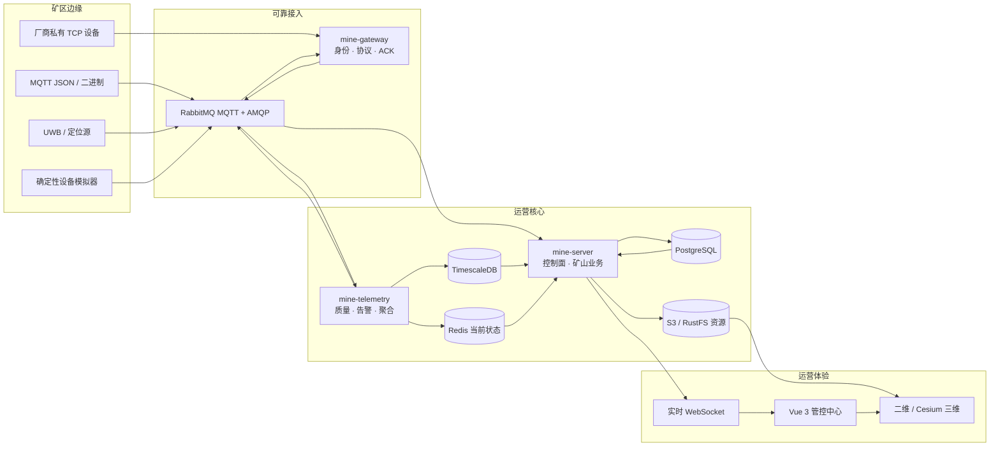

<div align="center">

# ⛏️ mine-platform

### 面向智慧矿山的开源工业 IoT 基础设施

**离线优先 · 弱网友好 · 协议可扩展 · 围绕可信运营事实构建**

[](https://github.com/Boscodoggggg/mine-platform/actions/workflows/ci.yml)
[](LICENSE)
[](https://openjdk.org/projects/jdk/21/)
[](https://vuejs.org/)
[](#项目成熟度)

[English](README.md) · [完整文档](docs/README.md) · [单机部署](deploy/README.md) · [参与贡献](CONTRIBUTING.md) · [安全策略](SECURITY.md)

</div>

---

mine-platform 是面向矿区私有化部署的 IoT 与生产运营平台。在矿区网络不稳定、厂商协议碎片化、现场不能依赖公网云服务的前提下，它把 MQTT、私有 TCP、二进制设备与定位源接入可靠的遥测、告警、命令、空间事件和生产作业闭环，并完整部署在矿区内网。

它不是给通用 IoT 后台换一套矿山皮肤。仓库显式建模矿山系统真正困难的部分：可重放采集、可信设备身份、事件时间排序、双坐标、围栏、班次、运输作业单、不可变运营证据、离线交付和恢复边界。

> [!IMPORTANT]
> 仓库已经具备较完整的自动化工程基线，目前处于 **Phase 4 生产加固阶段**。真实设备、现场标定、目标容量、高可用、灾难恢复演练和 24/72 小时长稳证据完成前，不得作为客户生产放行版本。

## 为什么是 mine-platform

| | 能力 | 现场价值 |
|---|---|---|
| 🔌 | **协议可扩展边缘接入** | 同时支持配置型 MQTT JSON 与版本化 MQTT/TCP 二进制插件，设备身份由平台可信上下文决定。 |
| 📡 | **弱网下仍然正确** | 使用序号、启动身份、Inbox/Outbox、发布确认、重试和迟到语义，而不是假设消息永不重复、永不乱序。 |
| 🧭 | **矿山原生空间模型** | 覆盖矿区、车辆、人员、标签、UWB、双坐标、路线、围栏以及确定性的进入/离开/停留事件。 |
| 🚛 | **不止采集，更有运营闭环** | 班次、运输作业单、异常候选、不可变事实、追加修正和固定水位统计直接进入领域模型。 |
| 🚨 | **受治理的告警与通知** | 版本化策略、持久状态机、确认/关闭闭环、平台内置 Provider 控制面和不可变升级策略。 |
| 🗺️ | **离线二维/三维工作台** | Cesium 资源完全本地化，叠加实时运营事实；WebGL 或三维资源失败时二维能力独立可用。 |
| 📦 | **私有化与离线交付** | 可复现 Standalone Compose、镜像锁、SBOM、校验和、健康门禁和离线安装包。 |
| 🛡️ | **默认拒绝不确定性的恢复** | 同版本冷备恢复校验 manifest、双层摘要、归档路径和镜像 ID，并且只恢复到不存在的新卷。 |

## 系统架构



控制面与数据面明确分离。已发布配置不可变，并以运行快照分发；设备报文不能自行选择插件、租户或矿区。PostgreSQL/TimescaleDB 保存历史事实，Redis 只承担可重建的当前状态。

## 已有能力

| 领域 | 自动化基线 |
|---|---|
| 设备接入 | MQTT JSON、MQTT 二进制插件 SPI、TCP 二进制插件 SPI、TLS、身份快照、命令 ACK 和确定性模拟器 |
| 遥测链路 | 统一消息、质量策略、幂等处理、TimescaleDB 历史、Redis 当前值和 WebSocket 实时更新 |
| 数据治理 | 产品/设备模型、版本化策略、保留保护、数值聚合、有界重算和审计 |
| 告警闭环 | 双来源计算、持久状态机、可靠事件、确认/关闭和通知控制面 |
| 矿山业务 | 矿区作用域、资产、时态绑定、UWB 位置、双坐标、路线、围栏、班次和作业单 |
| 可视化 | 实时定位、有界轨迹、空间/运营叠加、安全 GLB/3D Tiles 和二维独立降级 |
| 交付运维 | Standalone Compose、可观测性、离线包、镜像锁、CycloneDX SBOM 和同版本冷恢复 |

准确的已实现/延期矩阵见 [路线图](docs/12-roadmap-and-codex-workflow.md)，公开接口契约见 [OpenAPI](docs/openapi/mine-api.yaml)。

## 技术栈

| 层级 | 技术 |
|---|---|
| 后端 | Java 21、Spring Boot 4、MyBatis、Sa-Token、Flyway |
| 设备边缘 | Netty、Eclipse Paho、版本化 Java 协议 SPI |
| 消息 | RabbitMQ 4 MQTT/AMQP、quorum 队列、死信和发布确认 |
| 数据 | PostgreSQL 18、TimescaleDB OSS、Redis |
| 前端 | Vue 3、TypeScript、Vite、Naive UI、ECharts、Cesium |
| 对象存储 | 标准 S3 API；Standalone 基线使用 RustFS |
| 质量与交付 | JUnit、Testcontainers、Vitest、Playwright、Docker Compose、Prometheus、Grafana、Loki、Alloy、CycloneDX |

## 快速开始

### 1. 构建并运行自动化基线

需要 JDK 21、Node.js 20.19+、pnpm 10.5+、Docker Engine 24+ 和 Compose v2。

```bash
git clone https://github.com/Boscodoggggg/mine-platform.git
cd mine-platform

./mvnw -B -ntp test
pnpm --dir mine-web install --frozen-lockfile
pnpm --dir mine-web typecheck
pnpm --dir mine-web test:unit
pnpm --dir mine-web build
```

运行包含部署契约和 SBOM 的完整仓库门禁：

```bash
bash scripts/verify.sh
```

### 2. 启动 Standalone 环境

单机生产形态基线包含三个应用服务、RabbitMQ、PostgreSQL、TimescaleDB、Redis、RustFS、HTTPS/MQTTS 入口以及可选的可观测组件。

按照 [Standalone 部署文档](deploy/README.md) 创建本地 secret、执行前置检查并启动。真实矿区严禁继续使用示例凭据或开发证书。

### 3. 模拟矿山设备

使用独立的 [矿山设备模拟台](mine-device-simulator-app/README.md)，无需厂商硬件即可复现 MQTT、TCP、弱网和定位场景。

## 仓库结构

```text
mine-gateway/              设备身份、MQTT/TCP 协议和命令投递
mine-telemetry/            遥测、质量、告警、聚合和持久化
mine-server/               管理 API 与矿山运营领域
mine-device-model/         共享设备、策略和定位契约
mine-protocol-sdk/         稳定二进制协议插件接口
mine-protocol-engine/      配置型与插件型协议运行时
mine-web/                  Vue 运营与治理工作台
mine-device-simulator-app/ 独立矿山设备模拟台
deploy/                    Compose、离线交付、可观测性和恢复
docs/                      架构、契约、手册、报告和计划
```

## 项目成熟度

项目当前为 **Pre-1.0**。自动化测试证明受控环境下的仓库行为，不等于客户生产验收已经签字。

每个生产交付至少还需要完成：

- 真实厂商协议和设备认证；
- 矿区坐标、地图、围栏和运营规则标定；
- 客户浏览器/GPU 和目标容量测试；
- 通知真实送达和值班升级演练；
- 高可用、持续备份/PITR 和灾难恢复演练；
- 弱网、断电和 24/72 小时长稳；
- 安全评审、证书轮换和矿区威胁建模。

权威边界见 [测试与上线质量门禁](docs/10-testing-quality-gates.md)。

## 路线图

- [x] Phase 0 — 工程、安全、CI 与 Standalone 底座
- [x] Phase 1 — MQTT 设备到页面纵向闭环
- [x] Phase 2 — 策略、告警、保留、聚合和二进制协议基线
- [x] Phase 3 — 矿区资产、定位、空间事件、生产运营和二维/三维工作台
- [ ] Phase 4 — 生产加固：持续备份/PITR、升级编排、HA、容量、安全和长稳证据

## 文档

- [文档总览](docs/README.md)
- [后端架构与仓库说明](docs/02-repository-backend.md)
- [消息与遥测](docs/05-messaging-telemetry-data.md)
- [矿山业务模型](docs/06-mine-business.md)
- [安全、认证与审计](docs/08-security-auth-audit.md)
- [部署与运维](docs/09-deployment-operations.md)
- [测试与质量门禁](docs/10-testing-quality-gates.md)
- [Standalone 部署](deploy/README.md)

## 参与贡献

欢迎提交 Issue、设计讨论和 Pull Request。请先阅读 [CONTRIBUTING.md](CONTRIBUTING.md) 与 [分支及发布策略](docs/13-branching-and-release.md)。项目采用短生命周期分支、中文 Conventional Commit、测试先行和受保护的 `main`。

如果这个方向对你的矿山、集成团队或工业 IoT 项目有价值，欢迎 Star 并分享具体场景。可复现的厂商协议样本和真实现场约束尤其有价值。

## 安全

漏洞或泄露凭据不得提交公开 Issue。请遵循 [SECURITY.md](SECURITY.md)，使用 GitHub 私密漏洞报告。

## 许可证

mine-platform 使用 [Apache License 2.0](LICENSE)。第三方组件继续遵循各自许可证，详见 `THIRD-PARTY-NOTICES.md` 和构建生成的 CycloneDX SBOM。
